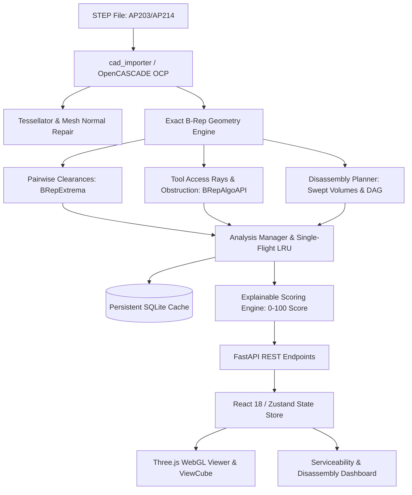
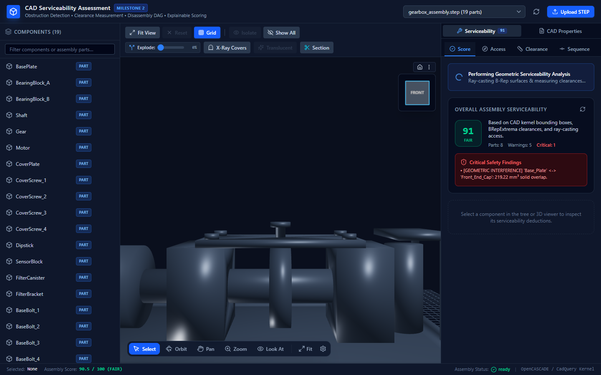
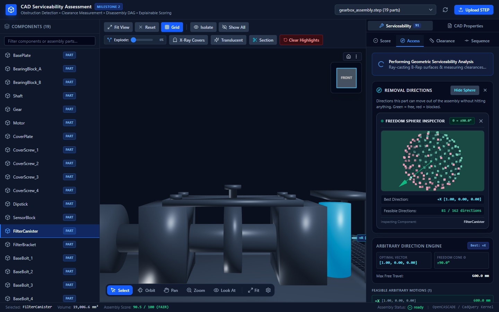
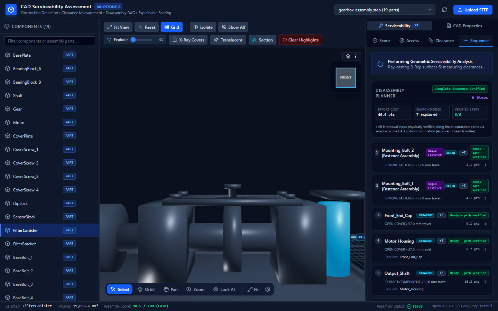
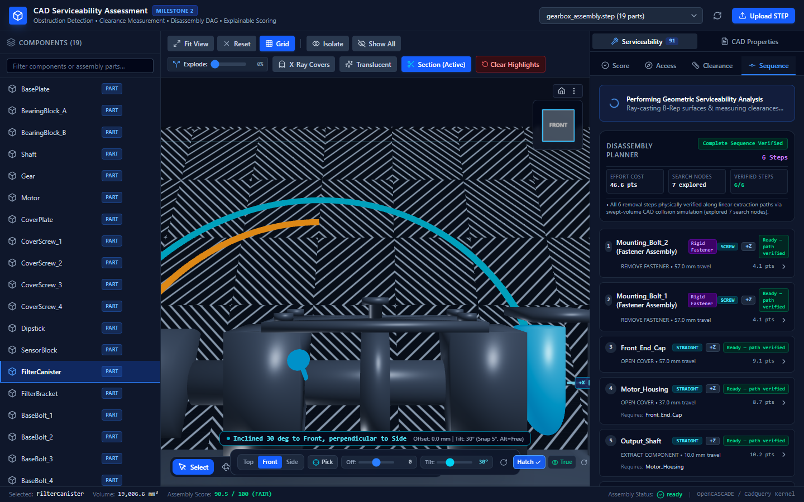
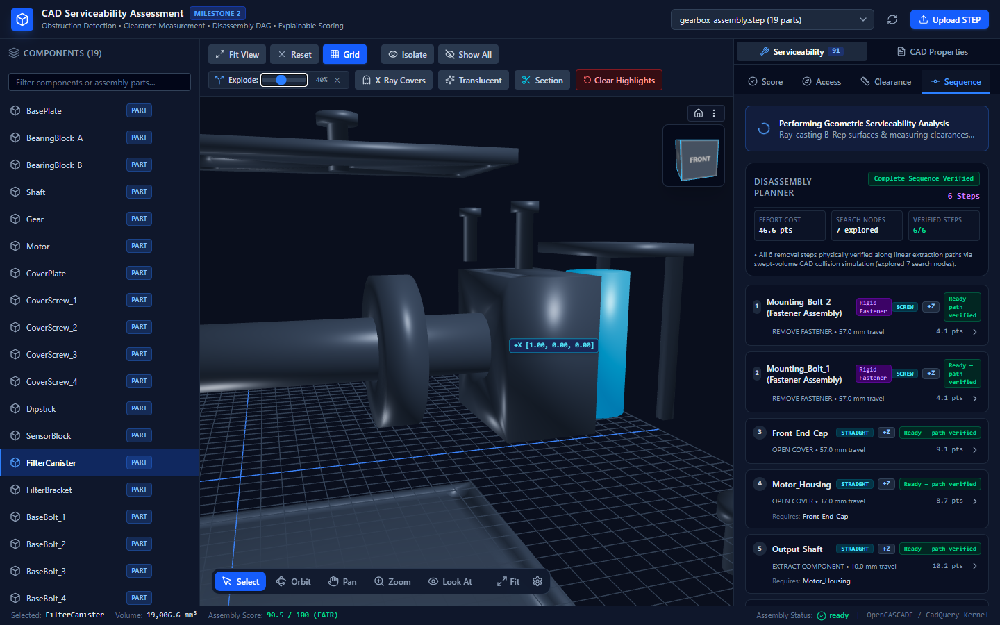
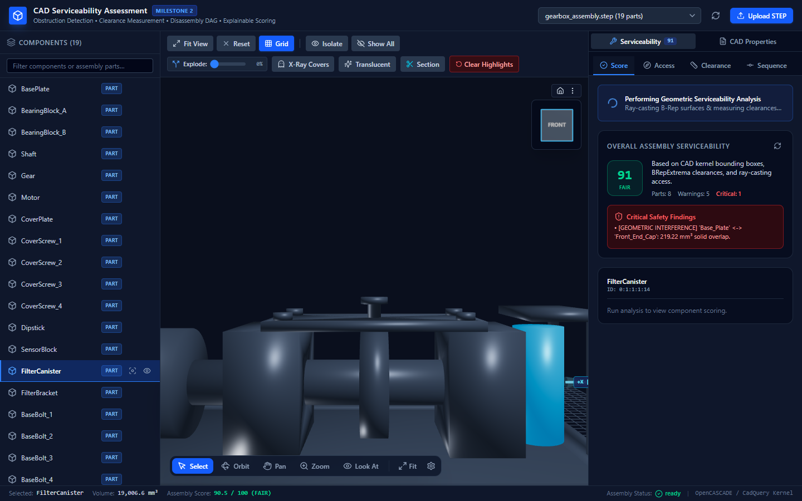

# CAD Serviceability Assessment System

[](https://www.python.org/)
[](https://fastapi.tiangolo.com/)
[](https://react.dev/)
[](https://threejs.org/)
[]()

An engineering-grade, CAD-native serviceability assessment platform. It ingests standard mechanical assemblies (STEP format), calculates exact B-Rep clearances and interference volumes, determines directional tool approach accessibility, derives disassembly precedence graphs (DAG), and outputs an explainable 0–100 serviceability score with itemized deductions.

---

## The Engineering Problem

In mechanical design and field maintenance:
- **Service Accessibility Gaps:** 15–25% of unexpected maintenance costs arise from internal fasteners, filters, and wear components blocked by structural housings or rigid brackets.
- **Approximation Errors:** Mesh-only collision checkers suffer from chordal error, missing tight shaft fits or reporting phantom collisions.
- **Disassembly Complexity:** Technicians lack automated guidance on optimal part removal sequences, leading to unnecessary component teardowns.

This platform bridges CAD design and maintenance engineering using an exact boundary-representation (B-Rep) kernel via OpenCASCADE, coupled with interactive WebGL visualization.

---

## System Architecture



---

## Verified Benchmarks & Key Capabilities

- **100% Automated Test Pass Rate:** 115 backend tests pass cleanly in ~6.0 minutes (`pytest backend/tests`).
- **Mathematical Exactness:** Dipstick/Gear interference measured at **55.2205 mm³** (matches golden benchmark of 55.22 mm³ within 0.0005 mm³).
- **Persistent SQLite & LRU Caching:** Cold analysis on a 19-part gearbox takes **57.2 s** (continuous B-Rep swept-volume booleans). Warm reload returns in **89 ms** ($>600\times$ faster).
- **Multi-Axis Slicing:** Dynamic cross-section planes (Top, Front, Right, and arbitrary tilt up to 30°) with real-time hatching line shaders.
- **Continuous Swept Volume Planner:** Eliminates discrete jumping errors using `BRepPrimAPI_MakePrism` along candidate extraction vectors.
- **Assembly Revision Comparison:** Evaluates revision deltas between any two loaded CAD assemblies (`/compare`), tracking added/removed/modified components, volume deltas ($\Delta V$), bounding-box shifts, and overall serviceability score changes.

---

## Visual Feature Gallery

| 1. Score & Traceable Deductions | 2. 3D Freedom Sphere |
|:---:|:---:|
|  |  |
| *0–100 weighted score with line-item deductions* | *Directional tool clearance hemisphere* |

| 3. Step-by-Step Disassembly Sequence | 4. Custom Inclined Section Plane |
|:---:|:---:|
|  |  |
| *Topological removal DAG with animation slider* | *30° inclined cross-section with hatching pattern* |

| 5. Exploded View Inspection | 6. Component Isolation & Selection |
|:---:|:---:|
|  |  |
| *Radial centroid displacement control* | *Component tree selection with bounding wireframes* |

---

## Quick Start (Run in 3 Commands)

### Option A: One-Click Launcher (Windows)
Double-click `start_app.bat` in the repository root. This spins up the FastAPI backend and Vite frontend, then opens `http://localhost:5173`. Run `stop_app.bat` when done.

### Option B: Terminal Setup

1. **Start Backend Server:**
   ```bash
   cd backend
   pip install -r requirements.txt
   uvicorn app.main:app --host 127.0.0.1 --port 8000 --reload
   ```

2. **Start Frontend Server:**
   ```bash
   cd frontend
   npm install
   npm run dev
   ```

3. **Open Application:**
   Navigate to `http://localhost:5173` in your browser. Select `gearbox_assembly.step` to inspect results.

---

## Core API Endpoints

| Method | Endpoint | Description |
|---|---|---|
| `POST` | `/api/upload` | Ingests `.step` file with SHA-256 fingerprinting and background processing. |
| `GET` | `/api/assemblies` | Lists all imported CAD assemblies with component summaries. |
| `GET` | `/api/assemblies/{id}` | Retrieves full assembly metadata and component hierarchy. |
| `POST` | `/api/assemblies/{id}/analyze` | Computes or returns bundled clearances, obstructions, DAG, and score. |
| `POST` | `/api/assemblies/{id}/jobs/analyze` | Dispatches asynchronous background analysis worker task with polling job ID. |
| `GET` | `/api/analysis/jobs/{job_id}` | Polls status (`queued`, `running`, `complete`, `failed`) and stage progress of background analysis. |
| `GET` | `/api/assemblies/{a}/compare/{b}` | Computes revision deltas: added/removed/modified parts, volume & BB deltas, and score delta. |
| `GET` | `/api/geometry/{comp_id}` | Provides tessellated WebGL mesh buffers (vertices, faces, normals). |
| `PATCH` | `/api/components/{id}/label` | Updates user-assigned part classification labels. |
| `POST` | `/api/cache/clear` | Purges persistent SQLite cache and in-memory LRU. |
| `GET` | `/api/health` | System health check with runtime environment versions. |

---

## Limitations & Engineering Roadmap

- **Component Name Heuristics:** The disassembly solver utilizes name substrings (`baseplate`, `screw`, `bolt`, `gear`) to guide support constraints. Assemblies with arbitrary solid names (e.g. `SOLID_01`) use bounding box fallbacks, but benefit from manual labeling via the UI. *Roadmap: Pure geometric support plane detection.*
- **True B-Rep Geometric Diffing:** Revision comparison accurately computes metadata deltas, added/removed parts, volume differences ($\Delta V$), and bounding box changes between assemblies. *Roadmap: Exact 3D boolean face-level B-Rep subtraction diffing.*
- **Very Large Assemblies (200+ parts):** Cold analysis scaling on 200+ components can take several minutes due to $O(N^2)$ candidate swept-volume collisions. *Roadmap: GPU-accelerated BVH ray-culling.*
